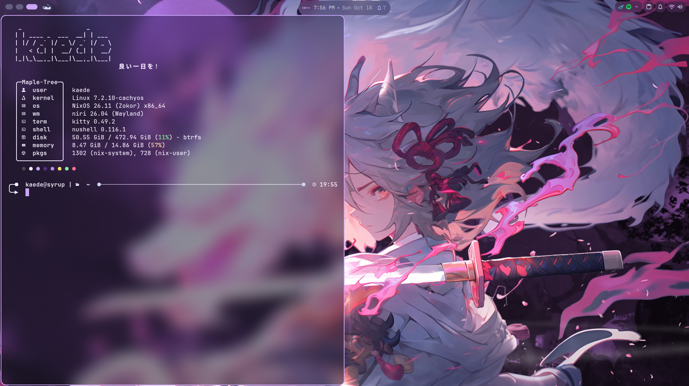

# Kaenix

My personal [NixOS](https://nixos.org/) configuration, built with Flakes and Home Manager for **syrup**.
[Repository](https://github.com/MapleKaedee/Kaenix) · [Getting started](#getting-started)

This configuration targets my installed `syrup` machine. [installation.nix](installation.nix) has `hardwareReady = true` and configures systemd-boot; both state versions remain `26.05`. Review the hardware and installation settings before using it on another installation. Repository changes still need a rebuild to become active.
## Desktop components

| Component | Choice |
| --- | --- |
| Wayland compositor | Niri + Xwayland Satellite |
| Desktop shell | DankMaterialShell (DMS) |
| Login screen | DankGreeter |
| Terminal | Kitty |
| Shell / prompt | Nushell (default) + Fish, with shared Starship |
| Command-line tools | eza, Fastfetch, Fish autopair |
| Nix formatting | nixfmt (`nixfmt`, `nix fmt`) |
| Browser | Brave |
| Editor | Zed |
| Theme | Catppuccin Mocha with Mauve|
| Fonts | JetBrains Mono and its Nerd Font variant |
| Audio / networking | PipeWire / NetworkManager |
| Audio controls / effects | Pavucontrol / EasyEffects |
| ASUS controls | asusd, asusctl, and ROG Control Center |

## Repository layout

```text
.
├── flake.nix                    # Inputs and the syrup NixOS configuration
├── flake.lock                   # Pinned dependency revisions
├── installation.nix             # Installation guard, bootloader, state versions
├── hardware-configuration.nix    # Hardware and mounts for syrup
├── configuration.nix            # System entry point
├── home.nix                     # Home Manager entry point
├── modules/
│   ├── default.nix              # Explicit category imports
│   ├── desktop/                 # Niri, DMS, fonts, and cursor theme
│   ├── shell/                   # Fish, Nushell, prompt, Git, and CLI tools
│   ├── apps/                    # Browser, terminal, messaging, media, and other apps
│   ├── hardware/                # NVIDIA, ASUS, power, tablet, and Bluetooth
│   ├── services/                # Audio, printing, automount, and session services
│   └── system/                  # Base settings, users, Nix, and Home Manager support
├── config/                      # Configuration assets and initial GUI settings
├── collection/                  # Wallpapers, including the mpvpaper video
├── scripts/                     # Writable-default initialization helper
└── tests/                       # Seed tests, Niri validation, evaluation fixture
```

## Screenshots


## Getting started

### Installation

```bash
git clone https://github.com/MapleKaedee/Kaenix.git
cd Kaenix
```

Before deploying this checkout to a new target:

1. Back up important data.
2. In `installation.nix` set the value with your own settings.
3. Review the user/host settings, GPU PCI addresses, kernel, and monitor outputs. Set `hardwareReady = true` after the target settings are ready in `installation.nix`.

Once the installation settings are ready, build and prepare the next boot:

```bash
nix flake check --no-build path:.
sudo nixos-rebuild build --flake path:.#syrup
sudo nixos-rebuild boot --flake path:.#syrup
sudo reboot
```
Or if you want to rebuild and switch at the same time:

```bash
sudo nixos-rebuild switch --flake path:.#syrup
```

## Monitoring builds

Home Manager installs `nix-output-monitor` from the pinned nixpkgs input. After rebuilding, use `nom build` explicitly to display build progress, downloads, and the dependency tree. For example, from this repository:

```bash
nom build --no-link path:.#checks.x86_64-linux.shells
```

The package also provides `nom-build` and `nom-shell` for the legacy Nix commands. These commands are available from Nushell and Fish. Monitoring `nixos-rebuild` requires piping its logs to `nom` separately; see the [upstream usage guide](https://github.com/maralorn/nix-output-monitor#running). The regular Nix commands are not aliased or replaced.

## Formatting Nix code

Home Manager installs `nixfmt` from the pinned nixpkgs input. After rebuilding, the `nixfmt` command is available from Nushell and Fish. The flake also provides `nixfmt-tree` as its formatter, so `nix fmt` works before system activation. Run these commands from the repository root:

```bash
# Format one file
nixfmt modules/shell/nix/home.nix

# Format all Nix files in the project
nix fmt

# Format only selected files
nix fmt -- flake.nix modules/shell/nix/home.nix
```

These commands write formatting changes to files. Formatting is explicit; no Git hooks or editor format-on-save settings are installed. See the [upstream documentation](https://github.com/NixOS/nixfmt#installation).

## References and inspiration

- [Ryan4Yin's nix-config](https://github.com/ryan4yin/nix-config) — inspiration for the README structure.
- [NixOS & Flakes Book](https://nixos-and-flakes.thiscute.world/) — learning and configuration reference.
